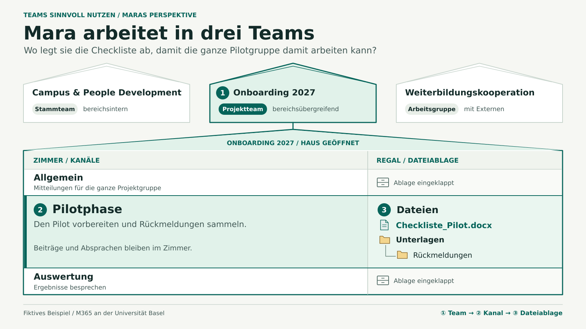

# Haus, Zimmer und Regal

Status: design concept for the next workspace visual. The illustration is a slide mockup. See the [current workspace handoff](WORKSPACE-PROFILE-HANDOFF.md) for implemented behaviour.

## Teaching objective

Someone working across several groups can choose a place for shared work by answering three questions.

| Layer | Metaphor | Decision |
| --- | --- | --- |
| Team | Haus | Who works together and needs access to the material? |
| Kanal | Zimmer | Which topic or workstream does it belong to? |
| Dateiablage | Regal or Dateischrank | Where in this channel’s shared files should the material live? |

A cabinet sits to the right of its room. Folders and subfolders are nested within the cabinet and belong to the same file layer. Posts and decisions belong in the room, and a post can link to the file’s canonical location.

## Slide 1 · The person’s houses and one cutaway

Start from Mara’s fictional perspective. Give the three houses the same visual weight at the top, then use an outline and marker **①** to identify the selected house.

| House | Teamtyp | Zusammenarbeit |
| --- | --- | --- |
| Campus & People Development | Stammteam | bereichsintern |
| Onboarding 2027 | Projektteam | bereichsübergreifend |
| Weiterbildungskooperation | Arbeitsgruppe | mit Externen |

Open **Onboarding 2027** below the overview. Draw **Allgemein**, **Pilotphase** and **Auswertung** as horizontal rooms stacked vertically. Align a filing cabinet to the right of every room. Highlight **② Pilotphase** and open its **③ Dateien** cabinet. Show `Checkliste_Pilot.docx` and the folder «Unterlagen», with «Rückmeldungen» nested inside. Keep the other cabinets visually collapsed. «Eingeklappt» is a presentation state.

Use a small **Teamtyp** badge and a separate **Zusammenarbeit** label under each house name. Team type describes the group’s purpose. Collaboration labels describe who works together. Allow the project or fictional tenant to define its own vocabulary. Actual visibility comes from the scenario’s membership and access assumptions. A badge alone grants no access and represents no native Teams label.

Ask «Wo legt Mara die Checkliste ab, damit die ganze Pilotgruppe damit arbeiten kann?» The audience should be able to explain why this work belongs in the project house.

## Slide 2 · The same route in the Teams scene

Keep the same house names and ordering in the Teams sidebar. Open **① Onboarding 2027**, select **② Pilotphase**, and place **③** on its file area. Show the same file and folder. To demonstrate a subfolder, open «Unterlagen» and keep the breadcrumb visible. Use the existing M365 renderer and application terms. Place the explanatory type tags outside the application chrome.

The first slide is a **Prinzip** view and the second is a **Szene** view. Keep the existing neutral workspace map as an alternative. A team-centred view can open a single house directly. For a personal workspace like Nora’s OneDrive, show the personal shelf without inventing a Teams house.

## Implementation handoff

- Keep one canonical workspace definition. Model the visible teams for a viewer separately from team type and collaboration tags. Reuse stable IDs for teams, channels, folders and files.
- Extend the person perspective to supply an ordered list of visible Teams and one selected team, channel and file location to both views. For the Teams scene, reuse its existing rail, channel header and file table. Extend the sidebar view model for multiple teams with one expanded group.
- Add the cutaway to the shared render path. Advertise its options through the MCP capability catalogue once the website, CLI and MCP can render it. A paired export should preserve names, order, selection and markers. Separate map and app components are useful for inserting these visuals into an existing deck.
- Acceptance: a participant can name Mara’s three houses, select the project house for the checklist, and recognise the identical path in the Teams scene. A nested folder stays visibly inside the file layer. Check readability at slide size and after placement in the 4:3 Uni Basel deck.
