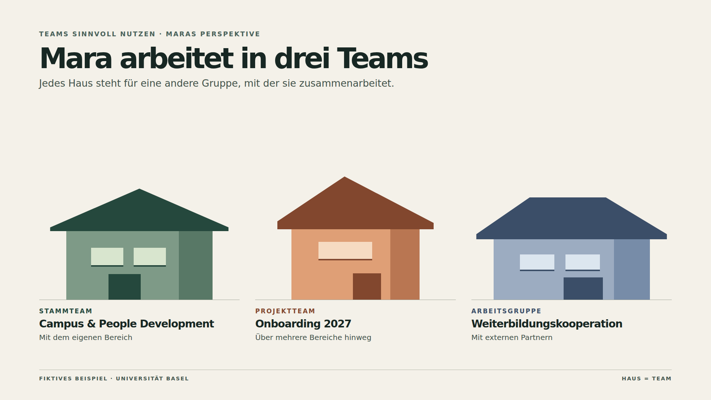

# Haus, Zimmer und Regal

The approved overview is the visual reference for the scenario-driven JavaScript renderer. The standalone mockup captures the art direction. The production views use workspace data and the shared render path.

[HTML and JavaScript source](mockups/three-houses.html)

## Teaching objective

Someone working across several groups can choose a place for shared work by answering three questions.

| Layer | Metaphor | Decision |
| --- | --- | --- |
| Team | Haus | Who works together and needs access to the material? |
| Kanal | Zimmer | Which topic or workstream does it belong to? |
| Dateiablage | Regal or Dateischrank | Where in this channel’s shared files should the material live? |

A cabinet sits to the right of its room. Folders and subfolders are nested within the cabinet and belong to the same file layer. Posts and decisions belong in the room, and a post can link to the file’s canonical location.

## Slide 1 · The person’s houses

Start from Mara’s fictional perspective. Show three houses side by side. Draw each channel as a named room in a horizontal row and align a filing cabinet to its right. Put the team name and a small team tile inside the house header beneath its roof. Add a team-type label and a short description of who works there. Give each channel one short purpose line and use a restrained Teams-inspired palette with a labelled file column. Use an architectural cutaway with a tiled roof, attic window, wall edges and a shared ground line. The team header borrows the initials tile and expand chevron from the Teams renderer; the rooms reuse its Fluent icons as visual cues for their purpose. The roof, room-purpose icons and cabinets are teaching devices. Keep the cabinets at icon level in the overview. Reveal file and folder names in the comparison with Teams.

| House | Teamtyp | Zusammenarbeit |
| --- | --- | --- |
| Campus & People Development | Stammteam | bereichsintern |
| Onboarding 2027 | Projektteam | bereichsübergreifend |
| Weiterbildungskooperation | Arbeitsgruppe | mit Externen |

## Slide 2 · One house beside Teams

Use **Onboarding 2027** for the worked example. The left column keeps the roof, team tile, the three rooms and their cabinets. The right column shows the existing Teams renderer with the channel navigation, tabs and file list. Mark the same **① team**, **② channel** and **③ file location** on both sides. The initial path is **Onboarding 2027 → Pilotphase → Dateien → Checkliste_Pilot.docx**. Opening «Unterlagen» exposes «Rückmeldungen» inside the same file layer.

Ask «Wo legt Mara die Checkliste ab, damit die ganze Pilotgruppe damit arbeiten kann?» Then follow the path in both views. Selecting a room or its Teams sidebar entry selects the same channel. Selecting a cabinet opens «Dateien». Clicking a folder or file in the mockup, or choosing it in the editor tree, updates the shared selection. Choose the team in the perspective selector. Other cabinets remain at icon level.

## Rebuild in JavaScript

- [workspace-core.js](../src/workspace-core.js) projects the ordered team roots and their channels for the overview. Membership determines visibility. Optional `teamType` and `collaboration` labels describe how the team works. They represent teaching metadata.
- [workspace-view.js](../src/workspace-view.js) builds the cutaway from each team and its channel array. Use inline SVG for the tiled roof, chimney and attic window. Use HTML and CSS grid for the team header, horizontal floors and the right-hand cabinet column. Reuse the existing Fluent icon helper and Teams initials. Draw the team name inside the outer walls and align the foundations across the overview. The overview uses a generic discussion icon and up to two lines of channel purpose.
- The side-by-side view uses one selection from `workspace.nodes` for both sides. Resolve the selection to its team, channel, folder and file using stable IDs. Keep the Teams rail, channel list, tabs, breadcrumb and file table in the [existing Teams renderer](../src/m365.js). Keep the house, team labels and cabinets outside the Teams mockup. For a folder, show the breadcrumb, and for a file, highlight its row.
- Both profiles use the same compiler, browser preview and PNG export. Interactions belong to the editor preview. PNGs capture the selected state. The neutral workspace map and Nora’s OneDrive example remain available via the original workspace profiles.

The approved reference covers three houses. The renderer supports one to four houses within the existing workspace budget. The Teams mockup on the comparison slide is scoped to the selected team. See the [workspace handoff](WORKSPACE-PROFILE-HANDOFF.md) for the portable fields and the CLI and MCP commands.
